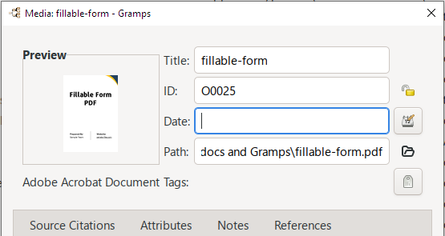

# PDF Thumbnailer for Gramps

PDF Thumbnailer is a Gramps addon that generates thumbnail images for PDF media files.

Instead of displaying a generic document icon, Gramps can display a thumbnail of the first page of a PDF document.

PDF Thumbnailer uses Ghostscript as its preferred PDF renderer, with Poppler available as an optional alternative and automatic fallback.



*Example of a PDF thumbnail generated in Gramps.*

## Features

- Generates a PNG thumbnail from the first page of a PDF.
- Supports normal and large thumbnail sizes used by Gramps.
- Preserves the aspect ratio of the original PDF page.
- Uses Ghostscript as the preferred PDF renderer.
- Automatically falls back to Poppler if Ghostscript is unavailable or fails.
- Automatically searches for the rendering executables.
- Caches discovered executable paths to avoid repeated searches.
- Supports Gramps 5.2 and 6.0.

## Requirements

- Gramps 5.2 or 6.0.
- Ghostscript and the Pillow Python imaging library (recommended), or Poppler as an alternative.

Ghostscript is a widely used, open-source interpreter and renderer for PostScript and PDF documents. It is available for Windows, Linux and macOS.

**Ghostscript and Pillow are already included in the tested Windows Gramps AIO64 installations (5.2.3 and 6.0.8). Users of these installations do not need to install any additional software.**

Neither Ghostscript nor Poppler is included with this addon.

Only one working rendering method is required. There is no need to install Poppler if Ghostscript and Pillow are available and working correctly.

## Installing PDF Thumbnailer

PDF Thumbnailer is available for Gramps 5.2 and Gramps 6.0 and can be installed through the Gramps Addon Manager.

To install:

1. Open Gramps and select **Edit → Addon Manager**.

2. Add a new addon project (you could name it Gramps-Addons) and use the URL appropriate to your Gramps version:

   **Gramps 5.2**

   `https://raw.githubusercontent.com/johnvitlin/Gramps-Addons/main/gramps52`

   **Gramps 6.0**

   `https://raw.githubusercontent.com/johnvitlin/Gramps-Addons/main/gramps60`

   Note: If you have already configured the Gramps-Addons project for another addon, you do not need to add it again.

3. Ensure the addon project is enabled and refresh the available addons.

4. Find **PDF Thumbnailer** in the addon list and install it.

5. Restart Gramps to activate PDF Thumbnailer.

PDF Thumbnailer is an independent addon and does not require Dynamic Web Extended (DWE) or any other third-party Gramps addon to be installed.

## Installing Ghostscript (if required)

Ghostscript may already be available within your Gramps installation or installed on your system.

If PDF Thumbnailer is working correctly, no further installation is required.

### Windows

Ghostscript is included in the tested Windows Gramps AIO64 installations. PDF Thumbnailer automatically locates the bundled Ghostscript executable without requiring any additional configuration.

If Ghostscript is not available in your Gramps installation, it can be downloaded from the official Ghostscript website:

**[Ghostscript Downloads](https://ghostscript.com/releases/)**

After installing Ghostscript, ensure that its `bin` directory is included in the `PATH` accessible to Gramps.

PDF Thumbnailer searches for the following Ghostscript executables, in order:

- `gswin64c.exe`
- `gswin32c.exe`
- `gs.exe`

Restart Gramps after installing Ghostscript or changing the system `PATH`.

### Linux

Ghostscript is available through the package managers of major Linux distributions and may already be installed.

To check whether Ghostscript is available, open a terminal and run:

```bash
gs --version
```

If required, install Ghostscript using your distribution's package manager.

For example:

**Ubuntu, Debian and Linux Mint**

```bash
sudo apt install ghostscript
```

**Fedora**

```bash
sudo dnf install ghostscript
```

**Arch Linux**

```bash
sudo pacman -S ghostscript
```

Ensure that the `gs` executable is available on the `PATH` accessible to Gramps.

### macOS

Ghostscript can be installed using a package manager such as Homebrew or MacPorts.

**Homebrew**

```bash
brew install ghostscript
```

**MacPorts**

```bash
sudo port install ghostscript
```

Ensure that the `gs` executable is available on the `PATH` accessible to Gramps.

Note that applications launched from the graphical desktop may have a different `PATH` from applications launched from a terminal.

### Pillow

PDF Thumbnailer uses the Pillow Python imaging library to resize images generated by Ghostscript to the thumbnail dimensions required by Gramps.

Pillow must be available within the Python environment used by Gramps. It is already included in the tested Windows Gramps AIO64 installations.

If Pillow is not available, PDF Thumbnailer will attempt to use Poppler instead.

## Using PDF Thumbnailer

PDF Thumbnailer is registered as a startup addon and is activated when Gramps starts.

PDF Thumbnailer runs automatically when Gramps requests a thumbnail for a PDF media object. No additional activation is required.

When generating a thumbnail, PDF Thumbnailer:

1. Attempts to locate Ghostscript and render the first page of the PDF.
2. Resizes the rendered image to the thumbnail dimensions required by Gramps, preserving the original page aspect ratio.
3. Attempts to use Poppler (if it is installed) if Ghostscript is unavailable or the Ghostscript rendering process fails.

If neither rendering method is available or successful, Gramps will continue displaying its normal document icon.

Gramps caches generated thumbnails, so PDF Thumbnailer does not need to render the PDF each time its thumbnail is displayed.

## Poppler — optional alternative

Poppler is a free, open-source PDF rendering library and collection of utilities used to read, process and convert PDF documents. PDF Thumbnailer uses its `pdftoppm` utility to generate thumbnail images.

Poppler is an alternative renderer for systems where Ghostscript or Pillow is unavailable, and as an automatic fallback if Ghostscript cannot successfully generate a thumbnail.

Poppler does not require Pillow.

**Installing Poppler is optional if Ghostscript is working correctly.**

### Installing Poppler on Windows

Poppler is available as a prebuilt Windows package from the following GitHub repository:

**[Poppler for Windows — Latest Release](https://github.com/oschwartz10612/poppler-windows/releases/latest)**

To install Poppler:

1. Open the link above and download the ZIP archive from the latest release.
2. Extract the archive to a suitable directory, such as `C:\Poppler`, or one of the locations listed below.
3. Locate `pdftoppm.exe`, normally found in the `Library\bin` subdirectory.
4. Restart Gramps.

PDF Thumbnailer automatically searches several common installation directories, including:

- `C:\Poppler`
- `C:\Program Files\Poppler`
- `C:\Program Files (x86)\Poppler`
- `C:\Tools\Poppler`
- `%LOCALAPPDATA%\Poppler`

Both direct installations and version-numbered subdirectories are supported. The addon also searches the system `PATH`.

If Poppler is installed elsewhere and cannot be found automatically, see **Optional Poppler configuration** below.

### Installing Poppler on Linux

Install Poppler using your distribution's package manager. Ensure that `pdftoppm` is available on the `PATH` accessible to Gramps.

### Installing Poppler on macOS

Install Poppler using a suitable package manager and ensure that `pdftoppm` is available on the `PATH` accessible to Gramps.

### Optional Poppler configuration

Advanced users can specify the full path to the Poppler executable using the environment variable:

`PDFTHUMBNAILER_PDFTOPPM`

This is normally unnecessary when Poppler can be found automatically.

This setting specifies the location of the Poppler executable. It does not override the preference for Ghostscript.

Restart Gramps after changing this setting.

## Troubleshooting

If PDF thumbnails are not being generated, check the following:

- PDF Thumbnailer has been installed and Gramps has been restarted.
- The PDF file is accessible and its media type is recognised as `application/pdf`.
- Ghostscript and Pillow are available within the Gramps environment, or Poppler is available as an alternative.
- Any required rendering executable can be located by PDF Thumbnailer.

PDF Thumbnailer writes warning messages to the Gramps log if a rendering attempt fails or neither rendering method can generate a thumbnail.

When debug logging is enabled for thumbnail generation, PDF Thumbnailer also reports which renderer successfully generated the thumbnail.

## Tested environments

PDF Thumbnailer version 0.1.1 has been successfully tested on Windows with:

- Gramps AIO64 5.2.3, including Ghostscript 10.03.1.
- Gramps AIO64 6.0.8, including Ghostscript 10.07.0.

Testing has included:

- Automatic discovery of Ghostscript and Poppler.
- Ghostscript and Poppler thumbnail generation.
- Automatic fallback to Poppler.
- Normal and large thumbnail sizes.
- Preservation of the original page aspect ratio.
- Graceful handling of unavailable renderers and simulated rendering failures.
- Thumbnail generation from large PDF documents.

PDF Thumbnailer has been designed to support Linux and macOS, but has not yet been tested on those platforms.

Feedback from Linux and macOS users is welcome.

## Licence

PDF Thumbnailer is free software distributed under the GNU General Public License, version 2 or later (GPL-2.0-or-later).

Copyright (C) 2026 John Vitlin.
